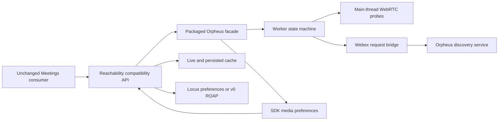

<!-- sdd-generated-metadata
doc_kind: module-spec
generated_from: module-spec@0.2.2
generated_by: codex
approved_by: repository user
updated_at: 2026-11-09
validation_status: not-run
-->
# REACHABILITY — SPEC

> Root [`AGENTS.md`](../../../AGENTS.md) · [`CONTRACTS.md`](../../../ai-docs/CONTRACTS.md) · [`RULES.md`](../../../ai-docs/RULES.md).

## Scope and provenance

Module `src/reachability/` remains **Partial** in the manifest. Source and mirrored tests are authoritative. The repository user approved replacing the legacy browser reachability engine with Orpheus, preserving the Meetings consumer contract and validating an unchanged web client against the built SDK. This document reconciles that approved change; independent spec validation has not run.

## Purpose and ownership

`Reachability` is the compatibility controller exposed by `webex.meetings.getReachability()`. Orpheus owns discovery-driven planning, UDP/TCP/xTLS probes, aggregation, refresh and cancellation. The controller owns Webex routing/credentials, protocol policy, compatibility storage/report formats, registration readiness, event scope and metrics submission.

The legacy `ClusterReachability` and `ReachabilityPeerConnection` engines are removed. No application-side instance replacement, Orpheus alias, loader or diagnostic UI is needed.

## Files and dependencies

| File | Responsibility |
| --- | --- |
| `index.ts` | Lazy composition, Webex HTTP bridge, compatibility methods and metrics |
| `orpheus-loader.ts`, `orpheus.types.ts` | Lazy packaged runtime import and typed adapter boundary |
| `orpheus/js/orpheus-client.d.ts` | Declaration for the build-staged browser entry |
| `reachability.types.ts` | Existing transport, report and metric vocabulary |
| `request.ts` | Retained advanced direct discovery and dormant SDP request helpers |
| `util.ts` | Existing protocol-policy and exported URL utilities |
| `scripts/orpheus-reachability-source.json` | Reviewed source repository and exact revision |
| `scripts/build-orpheus-reachability.cjs` | Build and stage browser entry, main-thread ICE executor, Worker and Wasm together |

External requirements: Webex host request/credential/service abstractions, browser Worker/WebRTC/WebAssembly APIs, and pinned Orpheus source. Constructing/importing Meetings does not start browser work.

## Public contracts

| Surface | Behavior |
| --- | --- |
| `gatherReachability(trigger)` | Disabled configuration rejects. Missing browser capabilities or caught runtime failure returns `{}`. Successful completion resolves `undefined`. Concurrent callers share work. Registration readiness is released after a 3-second window while a full gather may continue. |
| `gatherReachabilityFallback()` | Stops prior work and requests fresh SDK-owned discovery with fallback context; absorbs its documented internal failures. |
| `stopReachability()` | Stops probes/refresh, clears readiness timers, settles waiting callers and emits stopped for an active run. Retired generations cannot announce completion. |
| `shutdown()` | Idempotently stops the runtime and removes the page listener; also called on `pagehide`. |
| `getClusters(trigger, previousReport?, isRetry?)` | Retained direct discovery helper with one retry and cookie/option caching. Normal gathering does not reconstruct the Orpheus-owned request through this helper. |
| `getReachabilityResults()` | Complete cached cluster matrix in backend string-valued format, or undefined without results. |
| `getReachabilityReport()`, `getJoinCookie()` | Negotiated report version, minimum-cluster option, duration and current cookie. |
| `getClientMediaPreferences(isMultistream, ipver?)` | Real SDK preferences with existing IP-version and inverse-transcoding semantics. Version-one reports belong here; version-zero reports remain on ROAP. |
| `getReachabilityReportToAttachToRoap()` | Results for version zero; undefined for version one. |
| Reachability query methods | Preserve public/video-mesh distinctions. Fully unreachable requires every transport to have measured failure and no measured success; untested is not failed. |
| `getReachabilityMetrics()` | Preserve existing counters and NAT field. Orpheus currently supplies no symmetric-NAT classification, so NAT type remains unknown. |
| `getDiagnostics()`, `getLogLevel()`, `setLogLevel(level)` | Additive sanitized diagnostics and verbosity. Default warn through the normal Webex logger; no console bypass. |

Existing protocol/NAT/report types and URL utilities remain. The old per-UDP-URL toggle does not select a legacy engine: Orpheus isolates its browser probes itself.

## Events and state

- `reachability:firstResultAvailable` retains `{protocol}` and the existing event scope.
- `reachability:done` follows projection of the completed report into the compatibility cache, not early registration readiness.
- `reachability:stopped` is emitted for an active gather stopped by the consumer.
- Stop/disposal retire the local generation, settle callers and suppress late completion.
- Live reports/cookies take precedence over optional persisted cache data. Cache failures do not discard measured results.

## ADDED Requirements

| ID | WHAT | WHY | Evidence / tests |
| --- | --- | --- | --- |
| `REACHABILITY-R-006` | Build the exact pinned Orpheus revision and package its browser entry, main-thread ICE executor, Worker and Wasm together. Never commit generated output or require a sibling path at runtime. | Consumer builds must not depend on the prototype's frontend alias. | Build script/source manifest; `scripts/build-orpheus-reachability.test.cjs` |
| `REACHABILITY-R-007` | Lazy-load browser work, redact failures and preserve configurable normal logging thresholds with default warn. | Avoid browser-only import errors, production flooding and credential disclosure. | Loader/controller; `test/unit/spec/reachability/orpheus.ts` |

## MODIFIED Requirements

| ID | WHAT | WHY | Evidence / tests |
| --- | --- | --- | --- |
| `REACHABILITY-R-001` | Delegate normal discovery to Orpheus and route its original body through authenticated Webex `clusters` discovery and existing interceptors, including when Orpheus emits a logical `publicClusters` effect. | Preserve the working authenticated Meetings route rather than accidentally switching to public discovery. | `index.ts#fetchDiscovery`; `orpheus.ts` |
| `REACHABILITY-R-002` | Let Orpheus execute UDP/TCP/xTLS; apply disabled transport policy without mutating service responses. | Existing config stays authoritative; disabled means untested, not failed. | `fetchDiscovery`; `orpheus.ts` |
| `REACHABILITY-R-003` | Preserve disabled rejection, skip/failure sentinel, void completion and bounded registration readiness. | The full collection deadline must not hold registration. | `gatherReachability`; `orpheus.ts` |
| `REACHABILITY-R-004` | Delegate probe cleanup to Orpheus and retire host generations/listeners/timers idempotently. | Late callbacks or stopped initialization must not restart work or emit false completion. | `stopReachability`, `shutdown`; `orpheus.ts` |
| `REACHABILITY-R-005` | Preserve the full cluster matrix, cookie, IP version, trigger, report placement and metric outcomes, with live-cache fallback. | Storage failure/conversion must not discard connectivity evidence. | Report/cache methods; retained `index.ts` contract tests and `orpheus.ts` |

## Data flow

## Build and packaging

`yarn workspace @webex/plugin-meetings build:src` compiles the plugin and runs `build:orpheus` in the asset step. The runtime keeps relative module/Worker/Wasm URLs so the consumer bundler can emit its assets without application-specific configuration.

Prerequisites: the SDK Node/Yarn toolchain, Rust with the Wasm target, `wasm-pack` (verified locally with 0.13.1), and read access to the repository configured in `scripts/orpheus-reachability-source.json`. Source is cloned into an OS temporary cache. `ORPHEUS_SDK_DIR` optionally supplies an existing clean checkout at exactly the pinned revision; this is a build input, never a consumer runtime path. The script rebuilds Wasm and stages required files under ignored `dist/reachability/orpheus/`, recording revision and Wasm SHA-256 in `build.json`.

Publishing is not part of the build. CI/release environments must provision the toolchain and authorized source access. A fork's GitHub token may not read the private Orpheus repository; do not work around that by committing binaries or credentials.

## Errors, security and measurement

- Missing/invalid probes are not successful measurements. Disabled reachability rejects before the failure-absorbing gather boundary; unsupported browsers skip before runtime import.
- Keep cookies/tokens in host credential/cache paths. Adapter diagnostics do not include raw exception text, response bodies, addresses or credentials. Orpheus uses its sanitized diagnostic dispatcher.
- Request failures remain failures, with bounded SDK recovery. No second legacy probe engine runs as fallback.
- NAT classification remains unknown where not supplied by Orpheus. ICE/probe latency is not a claim of pure network RTT.

## Verification

Focused command: `yarn workspace @webex/plugin-meetings test:unit --targets 'reachability/{index.ts,orpheus.ts,request.js,util.ts}'`.

Retained `index.ts` cases cover public/video-mesh queries, fully-unreachable guards, backend conversion and metrics. New `orpheus.ts` cases cover 22-cluster projection, original authenticated requests, versioned report placement, disabled transports, readiness, initialization cancellation, stop races, storage failure and disposal. Authoritative probe-engine tests remain in Orpheus; local legacy-engine tests are replaced by adapter contracts.

Packaging tests: `node scripts/build-orpheus-reachability.test.cjs`. Build/type checking and browser validation are separate gates. Constructing preferences does not prove an outgoing Locus request: observe an authorized meeting join before claiming that. Cross-browser and symmetric-NAT characterization are separate verification work.
